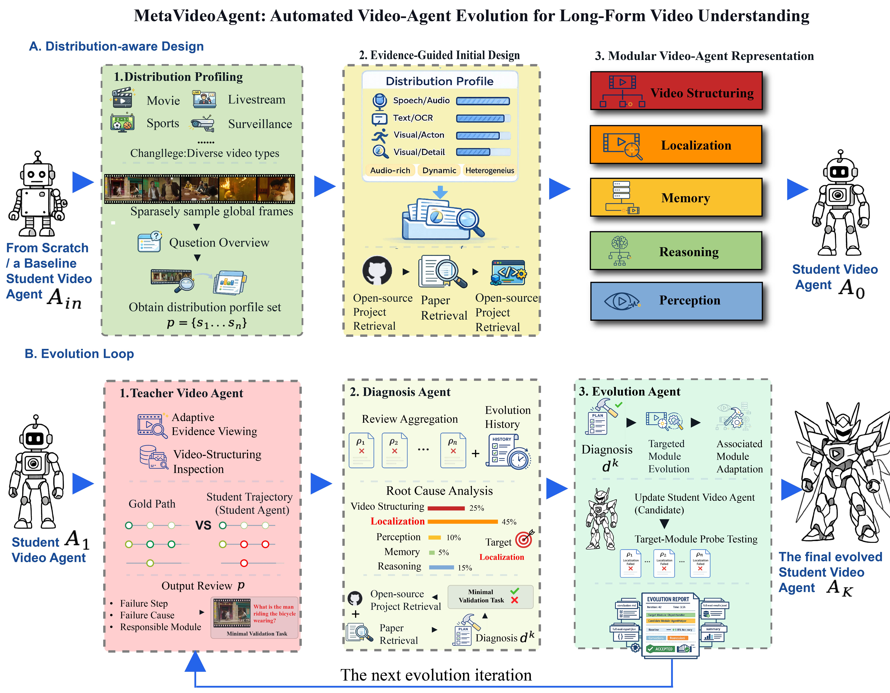

<div align="center">

# MetaVideoAgent

### Automated Video-Agent Evolution for Long-Form Video Understanding

Build a distribution-aware video agent from scratch, then improve its code through evidence-grounded review, diagnosis, and iterative evolution.

[](https://arxiv.org/abs/2608.04587) [](https://github.com/Alibaba-VELLDEPTH/MetaVideoAgent) [](VA-EvoBench/README.md) [](LICENSE)

Benlei Cui<sup>1,&#42;</sup>, Ruize Wang<sup>2,&#42;</sup>, Junjie Li<sup>1,&dagger;</sup>, Jinhao Chen<sup>3</sup>, Longtao Huang<sup>1</sup>, Yinghao Chen<sup>1</sup>, Yuwen Zhai<sup>1</sup>, Jingqun Tang<sup>4</sup>, Ruijian Jia<sup>1</sup>, Weiwei Wu<sup>2</sup>, Pengfei Sun<sup>1,&Dagger;</sup>, Haiwen Hong<sup>1,&dagger;</sup>

<sup>1</sup> Yuvion Team, Alibaba Group &nbsp; <sup>2</sup> Zhejiang University &nbsp; <sup>3</sup> Beihang University &nbsp; <sup>4</sup> ByteDance

<sup>&#42;</sup> Equal contribution &nbsp; <sup>&dagger;</sup> Corresponding author &nbsp; <sup>&Dagger;</sup> Project leader

</div>

## 🔍 Overview

Long-form videos differ in how visual, spoken, and temporal evidence is distributed. **MetaVideoAgent (MVA)** adapts the agent design to a target video distribution: sampled frames and queries guide initial research and modular agent construction, followed by code evolution grounded in execution trajectories. Teacher review, cross-sample diagnosis, and targeted research when needed guide updates across five modules: video structuring, localization, perception, memory, and reasoning. Minimal validation tasks and evolution-split evaluation test candidate changes before the next iteration.

<p align="center"></p>

<p align="center"><em>Distribution-Aware Design initializes the Student. Teacher review, cross-sample diagnosis, and modular code evolution form the improvement loop, with validation and evaluation guiding candidate acceptance.</em></p>

## ✨ Highlights

- **Distribution-aware initialization.** Sampled frames and associated queries guide initial research and agent design for each target distribution.
- **Evidence-grounded review.** The Teacher compares Student trajectories with a Gold Path grounded in evolution-split answers and annotated evidence.
- **Cross-sample diagnosis.** Recurring failures are traced to responsible modules, with targeted research used when additional evidence is needed to guide improvements.
- **Validated code evolution.** Updates focus on responsible modules and necessary dependencies; minimal validation tasks and full evolution-split evaluation assess candidate changes.

## 📊 VA-EvoBench

**VA-EvoBench** evaluates distribution-adaptive video-agent evolution across **eight target video distributions** curated from CG-Bench. It contains **130 videos and 1,223 questions**, with video-disjoint evolution and held-out splits within each distribution. Across all eight distributions, the evolution split contains 38 videos and 356 questions, and the held-out split contains 92 videos and 867 questions.

With four evolution iterations per distribution, the [paper](https://arxiv.org/abs/2608.04587) reports an increase in held-out macro-average accuracy from **38.44% to 51.47%** (**+13.03 percentage points**) across the eight distributions.

The [benchmark package](VA-EvoBench/README.md) includes annotations, split manifests, a validator, and an evaluator. See the [dataset card](VA-EvoBench/DATASET_CARD.md) for distribution details and the annotation-access protocol. Obtain videos separately from the [official CG-Bench release](https://huggingface.co/datasets/CG-Bench/CG-Bench) under its access conditions.

## 🚀 Quick Start

### 1. Install

Use Python 3.10 or newer, with FFmpeg and FFprobe available for video/audio processing. Automatic authoring requires an authenticated `codex` executable on `PATH` (or a path supplied through `--codex-cli`).

```bash
git clone https://github.com/Alibaba-VELLDEPTH/MetaVideoAgent.git
cd MetaVideoAgent
python -m pip install -e .
```

<details>
<summary>Pinned dependency baseline</summary>

```bash
python -m pip install -r requirements/reproduction.txt
python -m pip install -e . --no-deps
```

</details>

### 2. Configure Models

The default [capability profiles](evolution/agent_docs/capabilities/runtime_capability_profiles.json) specify the paper's runtime models and Alibaba Cloud Model Studio endpoints. Set your Model Studio API key in the shell before running:

```bash
export METAVIDEOAGENT_API_KEY="your-api-key"
```

[`.env.example`](.env.example) lists the supported environment variables; it is a template and is not loaded automatically. Runtime provider credentials are separate from Codex authentication.

<details>
<summary>Use another model provider</summary>

Fill in the model IDs in the [OpenAI-compatible profile template](configs/provider_profiles.openai_compatible.example.json), then select its profiles and your provider endpoint:

```bash
export METAVIDEOAGENT_CAPABILITY_PROFILES=configs/provider_profiles.openai_compatible.example.json
export METAVIDEOAGENT_BASE_URL=https://provider.example/v1
export METAVIDEOAGENT_LLM_PROFILE=custom.llm.reasoning
export METAVIDEOAGENT_EVOLUTION_LLM_PROFILE=custom.llm.evolution
export METAVIDEOAGENT_REVIEW_LLM_PROFILE=custom.llm.evolution
export METAVIDEOAGENT_POST_DECISION_LLM_PROFILE=custom.llm.evolution
export METAVIDEOAGENT_VLM_PROFILE=custom.vlm.default
export METAVIDEOAGENT_ASR_PROFILE=custom.asr.default
export METAVIDEOAGENT_OCR_PROFILE=custom.ocr.default
export METAVIDEOAGENT_EMBEDDING_PROFILE=custom.embedding.default
```

The reasoning profile serves the execution agent; the evolution, review, and post-decision profiles serve the corresponding orchestration stages. Use provider-supported models for each capability and keep credentials in the environment.

</details>

### 3. Prepare Data

Create a workspace containing raw videos and JSONL split files:

```text
workspace/
  raw_videos/
    <video_id>.mp4
data/
  train.jsonl
  test.jsonl
```

Evolution JSONL records need `video_id`, `question`, `choices` (or `options`), an answer such as `gt_answer`, and evidence intervals in `time_reference`. Intervals are `[start_sec, end_sec]` pairs in seconds with `end_sec > start_sec >= 0`, for example `[[0.0, 30.0]]`; see the [example record](examples/question.example.jsonl). Held-out records use the same question and answer fields; evidence intervals are optional.

Set the split paths in [the distribution manifest](configs/distribution_manifest.example.json). Paths are relative to that manifest. For VA-EvoBench, prepare one distribution per run using its released split membership and upstream videos.

The manifest's `train` split drives evolution and candidate selection; `test` is reserved for held-out reporting. Student execution uses video, question, and choices; evolution labels and evidence intervals are used in post-execution Teacher review.

### 4. Run Automatic Evolution

Initialize an agent from the target distribution and run four update rounds:

```bash
python scripts/run_automatic.py \
  --distribution-manifest configs/distribution_manifest.example.json \
  --workspace workspace \
  --run-id example_run \
  --output-root artifacts \
  --auto-rounds 4 \
  --run
```

Use `--check-only` instead of `--run` to validate the configuration and planned artifact paths without model calls. Select a coding model available in your Codex environment with `--codex-model` and set its reasoning effort with `--codex-reasoning-effort`. See `python scripts/run_automatic.py --help` for additional options. Generated agent code executes locally; use an isolated environment for evolution runs.

## 🧪 Evaluation

After evolution, open the JSON report identified by the terminal's `report_path` output. In `automatic_final_current_best`, `bundle_path` supplies `--candidate-bundle` and `report_path` supplies `--train-diagnostic-report`; use the corresponding candidate-run directory for `--candidate-run`. The train report must attest a completed evolution-split evaluation of the exact frozen bundle being evaluated:

```bash
python scripts/run_held_out.py \
  --distribution-manifest configs/distribution_manifest.example.json \
  --workspace workspace \
  --candidate-run artifacts/frozen_candidate_run \
  --candidate-bundle artifacts/frozen_current_best_bundle.json \
  --train-diagnostic-report artifacts/frozen_train_full_eval_report.json
```

Replace the example paths with your run artifacts. Held-out results are written under `<candidate-run>/held_out_evaluation` and do not affect evolution or candidate selection. Add `--check-only` to validate inputs without model calls.

## 📂 Repository Structure

```text
evolution/    distribution profiling, review, diagnosis, and code evolution
execution/    five-module agent runtime and workflow orchestration
VA-EvoBench/  benchmark annotations, splits, and evaluation utilities
scripts/      automatic evolution and held-out evaluation entry points
configs/      distribution manifests and model-provider examples
examples/     example inputs
```

## ✍️ Citation

If you use MetaVideoAgent or VA-EvoBench in your research, please cite our [paper](https://arxiv.org/abs/2608.04587):

```bibtex
@article{cui2026metavideoagent,
  title={Metavideoagent: Automated video-agent evolution for long-form video understanding},
  author={Cui, Benlei and Wang, Ruize and Li, Junjie and Chen, Jinhao and Huang, Longtao and Chen, Yinghao and Zhai, Yuwen and Tang, Jingqun and Jia, Ruijian and Wu, Weiwei and others},
  journal={arXiv preprint arXiv:2608.04587},
  year={2026}
}
```

## 📜 License

MetaVideoAgent is released under the [Apache License 2.0](LICENSE). See [third-party notices](THIRD_PARTY_NOTICES.md) for dependencies and the [VA-EvoBench notice](VA-EvoBench/NOTICE.md) for CG-Bench annotation and media terms. Research using VA-EvoBench should also cite CG-Bench as described in the [benchmark documentation](VA-EvoBench/README.md#licensing-and-citation).
